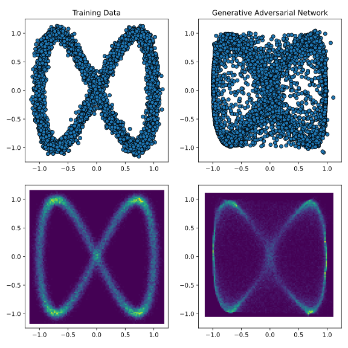
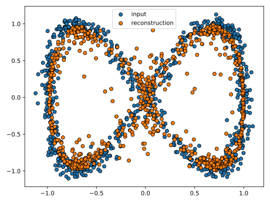
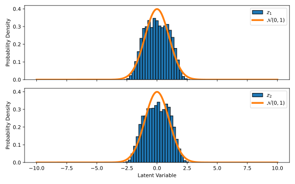
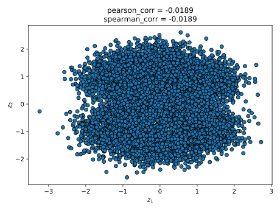

# Generative Adversarial Networks

To demonstrate how to use this module, we will train a Wasserstein Generative 
Adversarial Network (WGAN) {cite:p}`Ian2014, Arjovsky2017`, using a Variational 
Autoencoder (VAE) {cite:p}`Diederik2013, Larsen2015` as the generative model, 
to generate synthetic data that mirrors a two-dimensional target distribution. 
The VAE must learn to mimic this distribution using only the provided training 
samples, without direct access to the true underlying distribution or the 
ability to sample additional data.

For this example we will need to load the following modules
```python
import GenerativeModelProtocols as gen_prot
import numpy as np
```
let us consider the following function to generate our random two-dimensional 
data
```python
def make_data(num_samples):
    t = (2.0 * np.pi) * np.random.rand(num_samples)
    
    x_noise = 0.05 * np.random.randn(num_samples)
    y_noise = 0.05 * np.random.randn(num_samples)
    
    x = np.cos(1.0 * t) + x_noise
    y = np.sin(2.0 * t) + y_noise
    
    return np.vstack((x, y))


num_samples = 5000
train_data = make_data(num_samples)
```
we then define the WGAN-VAE that is to be trained on this data, whose latent 
variables are also two-dimensional as
```python
model = gen_prot.default_generative_adversarial_network(2,2)
```
however, unlike our VAE implementation that uses only one optimiser, we want 
to specify (in general) different optimiser settings for the cost function of 
the critic and the generator models, which we do as
```python
critic_optimiser = gen_prot.Adam(eta = 1.0E-4, beta = (0.0,0.9))
vae_optimiser = gen_prot.Adam(eta = 1.0E-3, beta = (0.95,0.999))
```
thus, our trainable generative model protocol is defined, and trained, as
```python
protocol = gen_prot.GenerativeModelProtocol(model, train_data)
protocol.train(
    beta         = 0.1, 
    gamma_vae    = 1.0, 
    gamma_wgan   = 0.1,
    grad_penalty = True, 
    lambda_      = 10.0, 
    a            = 1.0,
    batchsize    = 256,
    epochs       = 3500,
    optimiser    = (critic_optimiser, vae_optimiser)
)
```
finally, we can generate synthetic data by simply invoking our trained protocol
```python
synthetic_data = protocol(num_samples)
```


## Displaying models and protocols

As part of this module, printing all the relevant classes that users can need 
within this module is possible. We can easily read the configuration of 
`protocol` from the REPL by inputting
```pycon
>>> protocol
GenerativeModelProtocol:
training_data      = 2×5000 Matrix{Float64}
mean_training_data = Tuple{Float64, Float64}
var_training_data  = Tuple{Float64, Float64}
model              = GenerativeModelProtocols.GenerativeAdversarialNetwork
```
likewise, we can also read the configuration of model from the REPL by inputting
```pycon
>>> model
GenerativeModelProtocols.GenerativeAdversarialNetwork:
discriminator: 
   Chain(
      Dense(2 => 32, swish)
      Dense(32 => 32, swish)
      Dense(32 => 32, swish)
      Dense(32 => 32, swish)
      Dense(32 => 32, swish)
      Dense(32 => 1)
   )

encoders: 
   Chain(
      Dense(2 => 32, swish)
      Dense(32 => 32, swish)
      Dense(32 => 32, swish)
      Dense(32 => 32, swish)
      Dense(32 => 32, swish)
      Dense(32 => 4)
   )

decoders: 
   Chain(
      Dense(2 => 32, swish)
      Dense(32 => 32, swish)
      Dense(32 => 32, swish)
      Dense(32 => 32, swish)
      Dense(32 => 32, swish)
      Dense(32 => 2)
   )
```

## Model validation

So far, we have only validated our model by verifying that its synthetic data 
resembles the training data. However, we can perform at least two additional 
tests to assess whether the model is functioning as intended:
* __Test Data Reconstruction__: Encode and decode a separate, unseen test 
  dataset to see if the reconstructed data closely resembles the original.
* __Latent Space Validation__: Verify that all latent variables in our trained 
  VAE act as statistically independent random variables following a standard 
  normal distribution (zero mean and unit variance).

For our given example, we can easily test the ability of our trained model to 
reconstruct some inputted data by simply calling `protocol.encode` and 
`protocol.decode` as follows
```python
test_data = make_data(800)
z_test_data = protocol.encode(test_data)
recon_test_data = protocol.decode(z_test_data)
```



To test if the latent variables of our trained model follow a normal 
distribution with zero mean and unit variance we solely need to use the 
VAE's noise model, however, unlike our previous reconstruction example it is 
preferable to use a larger test dataset
```python
test_data = make_data(10000)
z_test_data = protocol.encode(test_data)
```



To evaluate whether the latent variables of our trained VAE behave as 
independent random variables by calculating the Pearson correlation coefficient 
or, more robustly, the Spearman rank correlation coefficient.
```python
from scipy import stats

pearson_corr, _ = stats.pearsonr(z_test_data[0,:], z_test_data[1,:])
spearman_corr, _ = stats.spearmanr(z_test_data[0,:], z_test_data[1,:])
```



the resulting correlations, visible in the illustration above, are close enough 
to zero to confirm that the latent variables are effectively independent.

## Source code

The scripts used to create and train the WGAN-VAE, and to produce all the plots 
shown in this page are included in the examples folder of this module.
```bash
cd /path/to/GenerativeModelProtocols.py/examples/intro_example/gan_example
python intro_example.py
```
