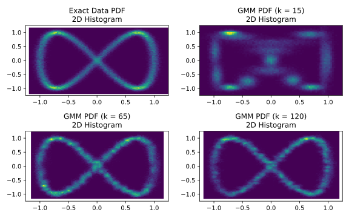

# Gaussian Mixture Models

To demonstrate how to use this module, we will train Gaussian Mixture Models 
(GMMs) {cite:p}`reynolds2009` to generate synthetic data that mirrors a 
two-dimensional target distribution. The GMMs must learn to mimic this 
distribution using only the provided training samples, without direct access to 
the true underlying distribution or the ability to sample additional data.

For this example we will need to load the following modules
```python
import GenerativeModelProtocols as gen_prot
import numpy as np
```
let us consider the following function to generate our random two-dimensional 
data
```python
def make_data(num_samples):
    t = (2.0 * np.pi) * np.random.rand(num_samples)
    
    x_noise = 0.05 * np.random.randn(num_samples)
    y_noise = 0.05 * np.random.randn(num_samples)
    
    x = np.cos(1.0 * t) + x_noise
    y = np.sin(2.0 * t) + y_noise
    
    return np.vstack((x, y))


num_samples = 5000
train_data = make_data(num_samples)
```
we then define the GMMs that are to be trained, with 15, 65 and 120 Gaussian 
clusters each, on this data
```python
k = [15, 65, 120]
models = [gen_prot.default_gaussian_mixture_model(2, ki) for ki in k]
```
thus, our trainable generative model protocols are defined, and trained, as
```python
protocols = [gen_prot.GenerativeModelProtocol(model, train_data) for model in models]

for i in range(len(protocols)):
    protocols[i].train(
        batchsize = 256,
        epochs    = 3500,
        optimiser = gen_prot.Adam(eta = 1.0E-3, beta = (0.95,0.999))
    )
end
```
finally, we can generate synthetic data by simply invoking our trained protocol
```julia
synthetic_data_1 = protocols[0](num_samples)
synthetic_data_2 = protocols[1](num_samples)
synthetic_data_3 = protocols[2](num_samples)
```


## Displaying models and protocols

As part of this module, printing all the relevant classes that users can need 
within this module is possible. We can easily read the configuration of 
`protocol` from the REPL by inputting
```pycon
>>> protocols[0]
GenerativeModelProtocol:
training_data      = 2×5000 Matrix{Float64}
mean_training_data = Tuple{Float64, Float64}
var_training_data  = Tuple{Float64, Float64}
model              = GenerativeModelProtocols.GaussianMixtureModel
```
likewise, we can also read the configuration of model from the REPL by inputting
```pycon
>>> models[0]
GenerativeModelProtocols.GaussianMixtureModel{Float64}:
μ      = 15×2 Matrix{Float64}
log_σ² = 15×2 Matrix{Float64}
p      = 15-element Vector{Float64}

predictor_network: 
   Chain(
      Dense(2 => 32, swish)
      Dense(32 => 32, swish)
      Dense(32 => 32, swish)
      Dense(32 => 32, swish)
      Dense(32 => 32, swish)
      Dense(32 => 15)
   )
```

## Model Validation

Across all three trained architectures, the generated synthetic data generally 
preserves the geometric structure of the reference training set. However, 
artifacts such as incorrect distribution shape, or scattered out of trend 
datapoints, particularly in the GMM with 15 Gaussian components which yields the 
most significant distributional divergence.

To overcome these visual anomalies, evaluating the 2D probability density 
function (PDF) via a 2D histogram or kernel density estimate offers a more 
rigorous and reliable assessment of how accurately the underlying distributions 
were learned.



## Source code

The scripts used to create and train the DM, and to produce all the plots shown 
in this page are included in the examples folder of this module.
```bash
cd /path/to/GenerativeModelProtocols.py/examples/intro_example/gmm_example
python intro_example.py
```

