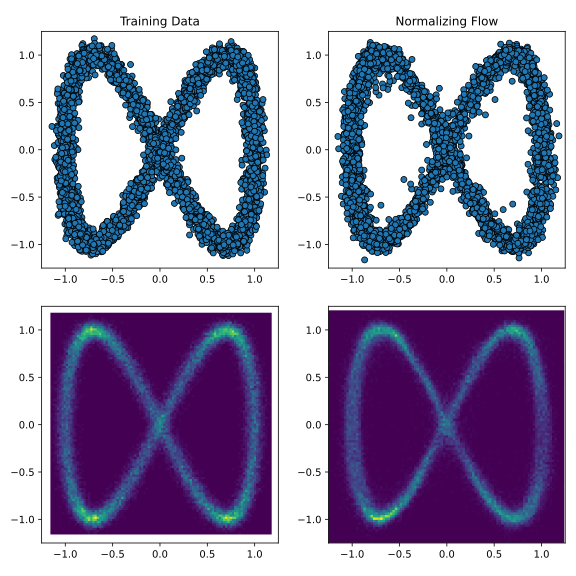
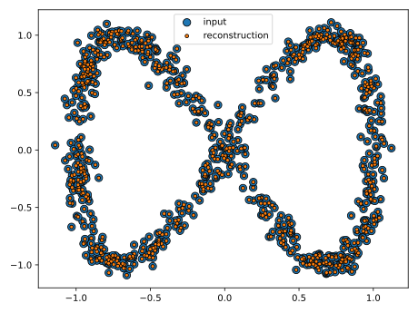
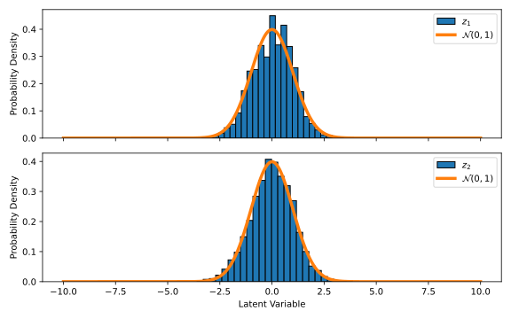
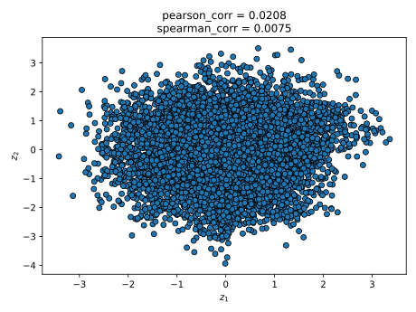

# Normalizing Flows

To demonstrate how to use this module, we will train a Normalizing Flow
(NF) {cite:p}`Danilo2015` to generate synthetic data that mirrors a 
two-dimensional target distribution. The NF must learn to mimic this 
distribution using only the provided training samples, without direct access to 
the true underlying distribution or the ability to sample additional data.

For this example we will need to load the following modules
```python
import generative_model_protocols as gen_prot
import numpy as np
```
let us consider the following function to generate our random two-dimensional 
data
```python
def make_data(num_samples):
    t = (2.0 * np.pi) * np.random.rand(num_samples)
    
    x_noise = 0.05 * np.random.randn(num_samples)
    y_noise = 0.05 * np.random.randn(num_samples)
    
    x = np.cos(1.0 * t) + x_noise
    y = np.sin(2.0 * t) + y_noise
    
    return np.vstack((x, y))


num_samples = 5000
train_data = make_data(num_samples)
```
we then define the NF that is to be trained on this data, whose latent variables 
are also two-dimensional as
```python
model = gen_prot.default_normalizing_flow(2)
```
thus, our trainable generative model protocol is defined, and trained, as
```python
protocol = gen_prot.GenerativeModelProtocol(model, train_data)
protocol.train(
    batchsize = 256,
    epochs    = 3500,
    optimiser = gen_prot.Adam(eta = 1.0E-3, beta = (0.95, 0.999))
)
```
finally, we can generate synthetic data by simply invoking our trained protocol
```python
gen_prot.load_differential_equations()
synthetic_data = protocol(num_samples)
```
it is also worth pointing out that while no Ordinary Differential Equation (ODE) 
solver is needed to train our NF {cite:p}`Lipman2022`, to encode and decode data 
with our trained NF an ODE solver is required.



## Displaying models and protocols

As part of this module, printing all the relevant classes that users can need 
within this module is possible. We can easily read the configuration of 
`protocol` from the REPL by inputting
```pycon
>>> protocol
GenerativeModelProtocol:
training_data      = 2×5000 Matrix{Float64}
mean_training_data = Tuple{Float64, Float64}
var_training_data  = Tuple{Float64, Float64}
model              = GenerativeModelProtocols.NormalizingFlow
```
likewise, we can also read the configuration of model from the REPL by inputting
```pycon
>>> model
GenerativeModelProtocols.NormalizingFlow:
velocity_field: 
   Chain(
      Dense(3 => 32, swish)
      Dense(32 => 32, swish)
      Dense(32 => 32, swish)
      Dense(32 => 32, swish)
      Dense(32 => 32, swish)
      Dense(32 => 2)
   )
```

## Model validation

So far, we have only validated our model by verifying that its synthetic data 
resembles the training data. However, we can perform at least two additional 
tests to assess whether the model is functioning as intended:
* __Test Data Reconstruction__: Encode and decode a separate, unseen test 
  dataset to see if the reconstructed data closely resembles the original.
* __Latent Space Validation__: Verify that all latent variables in our trained 
  NF act as statistically independent random variables following a standard 
  normal distribution (zero mean and unit variance).

For our given example, we can easily test the ability of our trained model to 
reconstruct some inputted data by simply calling `protocol.encode` and 
`protocol.decode` as follows
```python
test_data = make_data(800)
z_test_data = protocol.encode(test_data)
recon_test_data = protocol.decode(z_test_data)
```



To test if the latent variables of our trained model follow a normal 
distribution with zero mean and unit variance we solely need to use the 
NF's noise model, however, unlike our previous reconstruction example it is 
preferable to use a larger test dataset
```python
test_data = make_data(10000)
z_test_data = protocol.encode(test_data)
```



To evaluate whether the latent variables of our trained NF behave as 
independent random variables by calculating the Pearson correlation coefficient 
or, more robustly, the Spearman rank correlation coefficient.
```python
from scipy import stats

pearson_corr, _ = stats.pearsonr(z_test_data[0,:], z_test_data[1,:])
spearman_corr, _ = stats.spearmanr(z_test_data[0,:], z_test_data[1,:])
```



the resulting correlations, visible in the illustration above, are close enough 
to zero to confirm that the latent variables are effectively independent.

## Source code

The scripts used to create and train the NF, and to produce all the plots shown 
in this page are included in the examples folder of this module.
```bash
cd /path/to/GenerativeModelProtocols.py/examples/intro_example/nf_example
python intro_example.py
```